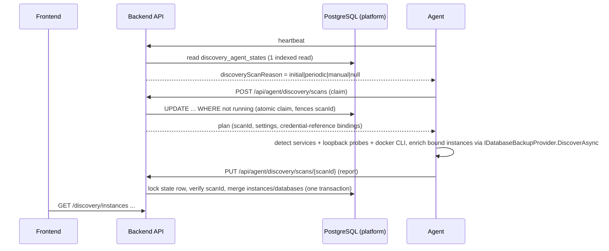

# Database Auto Discovery & Inventory — MSSQL / PostgreSQL

Branch: `feature/database-auto-discovery` (base `48ce43b1`, the committed HEAD of `feature/ui-db-full-readiness`).
Status: **Completed on the working branch (2026-10-16)** after integration with `main` (PR #18) and live acceptance on an isolated stack (section 9).
Earlier text of this document (sections 1–8) is the design; section 9 records what was really run and what it changed.

## 1. Goals and non-goals

An agent that has just been enrolled finds the MSSQL and PostgreSQL services on its own host (native and Docker), reports them, and the
platform keeps a tenant-scoped inventory of instances and databases. A user picks discovered databases in the Backup Job Wizard.

Non-goals (deliberate):

* No network scanning, no CIDR/range probing and no remote-host discovery. Only loopback and the local host's own service managers and Docker CLI are
  inspected, so there is no SSRF/unauthorised-network surface. A remote database is still addable by typing it into the existing wizard.
* Discovery never creates, changes or enables a backup job. A job exists only after a user confirms it in the wizard.
* No new orchestration: discovery rides on the existing heartbeat (a scan is *requested* in the heartbeat answer exactly like a capability sync) and
  the existing agent authentication; there is no second queue and no push message.
* Backup/restore code, the PostgreSQL provider and R1 are not modified.

## 2. Architecture



* **Agent side** (`BackupPlatform.Agent.Core/Discovery`, platform detectors in `agent/platform-windows` and `agent/platform-linux`): detectors only
  *find* things (`IInstanceDetector`). Enrichment reuses the existing provider `DiscoverAsync` (version, edition, database list, per-database
  full-backup capability). A scan runs in the background, single-flight, with a total time budget; it can never delay a heartbeat, a poll or a
  running backup/restore. A discovery failure is only reported, never propagated.
* **Backend** (`core/domain/Discovery`, `core/application/Discovery`, `core/infrastructure/Discovery`, `hosts/api/Endpoints/DiscoveryEndpoints.cs`):
  persistent inventory in PostgreSQL. All writes of one agent are serialised by a row lock on its `discovery_agent_states` row, so several backend
  nodes, repeated reports and backend restarts converge on one consistent state; a stale report (wrong `scanId`) is refused.
* **Capability gating**: agents advertise `discovery.database-inventory`. The backend asks for an initial scan only when that capability is stored as
  `Supported`, and refuses rescan/verify of an agent without it (`409 discovery_unsupported`). Older agents simply keep working.

## 3. Detection (agent)

| Source | Windows | Linux | Both |
|---|---|---|---|
| `Service` | Registry: SQL Server `Instance Names\SQL` (default + named instances, TCP port from `SuperSocketNetLib\Tcp\IPAll`, edition/version from `Setup`); PostgreSQL services under `HKLM\SOFTWARE\PostgreSQL\Installations` and `Services\postgresql*` (port from `postgresql.conf` when readable, else default) | systemd units (`mssql-server`, `postgresql*`), `pg_lsclusters` (version/cluster/port/status), `/etc/postgresql/*/*/postgresql.conf`, `/var/opt/mssql/mssql.conf` when readable | |
| `Listener` | | | Loopback TCP connect + credential-free handshake on candidate ports (MSSQL TDS PreLogin → version, PostgreSQL SSLRequest → `S`/`N`). Candidate ports = well-known ports (1433, 5432) plus ports found by the service source. Never a range. |
| `Docker` | | | `docker ps` through the `docker` CLI (no socket access requirement of ours): image/port mapping identify MSSQL (`mcr.microsoft.com/mssql/server`, container port 1433) and PostgreSQL (`postgres`, `bitnami/postgresql`, `postgis/postgis`, …, container port 5432). Absent CLI, no permission or timeout → source status `Unavailable`/`Failed`, scan continues. |

Instances found by several sources are merged by loopback port (a service registration wins the identity; the listener answer adds version and
reachability). Every source reports a status (`Scanned`/`Unavailable`/`Disabled`/`Failed` + reason code). Instance identity (`instanceKey`):
`mssql|service|<INSTANCE>` (`MSSQLSERVER` is `default`), `postgres|service|<service or cluster name>`, `<engine>|docker|<container name>|<container port>`,
`<engine>|listener|<port>`.

Passive and cheap: file/registry reads, one short TCP connect per candidate port, one `docker ps` call. Concurrency is bounded
(enrichment of at most 2 instances at a time), every connection has a finite timeout, and the whole scan has a deadline (`plan.timeoutSeconds`).

### Credentials

Finding an instance is **not** access. An instance without a bound credential is reported `access = CredentialsRequired`, `databases = null`.
The user binds an *agent-local credential reference* (the same mechanism as a backup job: `BACKUP_AGENT_SECRET_<reference>` read by the agent at
use time) or integrated security (MSSQL, Windows) to an instance. The backend stores only the reference name and the encrypt/trust flags; the plan
carries them back to the agent; secrets are never in the plan, the report, the database, a log line or an error message (provider failures are
reduced to fixed reason codes).

## 4. Inventory model (backend)

`discovery_agent_states` (PK `AgentId`, FK tenant): settings (`Enabled`, `ScanIntervalMinutes`, `IncludeDocker`), scan control (`ScanRequestedAt`,
`ScanRequestReason`, `RequestedInstanceKey`, `ScanId`, `ScanStartedAt`, `NextScanDueAt`), last result (`LastScanAt`, `LastSuccessfulScanAt`,
`LastOutcome`, `LastFailureCode`, `SourcesJson`).

`discovery_instances` (unique `(AgentId, InstanceKey)`): identity + descriptive fields, `Presence` (`Present`/`Missing`), `MissCount`,
`Reachability`, `Access`, full-backup support, credential binding (`CredentialReference`, `IntegratedSecurity`, `Encrypt`,
`TrustServerCertificate`), `FirstSeenAt`, `LastSeenAt`, `LastChangeKind/At`, `DatabasesCheckedAt`.

`discovery_databases` (unique `(InstanceId, Name)`): `IsSystem`, `State`, full-backup support, `Presence`, `FirstSeenAt`, `LastSeenAt`.

Merge rules (pure function `DiscoveryMerger`, unit-testable without a database):

* Duplicate prevention: unique keys plus upsert by `InstanceKey`/database name; a report is idempotent.
* New instance → `LastChange = Discovered`. A material change (version, edition, port, host, source details) → `Changed`. Reachable→unreachable →
  `Unreachable`; back → `Recovered`.
* **Nothing is deleted on absence.** An instance missing from a scan whose source was `Scanned` gets `MissCount++`; at 2 consecutive misses it becomes
  `Missing` (`LastChange = Missing`); it reappears as `Reappeared`. Instances of sources that were `Unavailable`/`Failed`/`Disabled` in the scan, and
  every instance of a `Failed` scan, are left untouched. A targeted scan (`onlyInstanceKey`) only narrows the credential enrichment; passive detection
  still runs, so it is merged like any other scan.
* Databases are replaced only when the report enumerated them (`databases != null`); a database that vanished from an enumeration becomes `Missing`
  and is purged 30 days after it was last seen. When enumeration was not possible the old list stays, `DatabasesCheckedAt` tells how old it is, and
  the UI does not offer it for job creation unless `access = Authenticated`.
* Limits are validated at the trust boundary (≤ 64 instances, ≤ 5000 databases per instance and ≤ 20 000 per report, bounded string lengths, known enum names, 4 MiB body). The agent omits a database list that would not fit (`accessReasonCode = too_many_databases`) instead of truncating it, because a cut list would turn the databases beyond the cut into "missing".

Scheduling: `NextScanDueAt = claim time + ScanIntervalMinutes (default 360, 15..10080) ± 10 % jitter`. A claim is rejected while another scan of the
agent started less than 10 minutes ago, so duplicated heartbeats or several backend nodes cannot start parallel scans. A manual request is refused
within 30 seconds of the previous one (`429 rescan_too_soon`).

## 5. API

Errors follow the existing shape `{ "error", "field"?, "code"?, "message"? }`.

### Agent (agent scheme + protocol header, rate limited like heartbeat)

* Heartbeat answer: `discoveryScanReason: "initial"|"periodic"|"manual"|null`.
* `POST /api/agent/discovery/scans` → `200 AgentDiscoveryPlan` | `204`.
* `PUT /api/agent/discovery/scans/{scanId}` body `AgentDiscoveryReport` → `204` | `400 invalid_request` | `409 scan_superseded`.
* Wire types: `backup-backend/src/core/contracts/Discovery/DiscoveryContracts.cs`.

### Tenant (`/api/tenants/{tenantId}/discovery/...`; Viewer reads, Operator rescans/verifies/binds, Administrator changes settings)

| Method | Path | Role | Result |
|---|---|---|---|
| GET | `/agents` | Viewer | `{ items: DiscoveryAgentStatus[] }` (only agents that have a state row) |
| GET | `/instances?agentId=&engine=&includeMissing=` | Viewer | `{ items: DiscoveryInstanceSummary[] }` |
| GET | `/instances/{id}` | Viewer | `DiscoveryInstanceDetail` (summary + `databases[]` with matching existing jobs) |
| POST | `/agents/{agentId}/rescan` | Operator | `202 DiscoveryAgentStatus`; `404`, `409 discovery_unsupported`, `409 discovery_disabled`, `429 rescan_too_soon` (+`Retry-After`) |
| POST | `/instances/{id}/verify` | Operator | `202 DiscoveryAgentStatus` (targeted scan of this instance); `409 credentials_required` |
| PUT | `/instances/{id}/credential` | Operator | `200 DiscoveryInstanceSummary`; body `{ credentialReference: string\|null, integratedSecurity, encrypt, trustServerCertificate }`; `400` invalid reference / integrated on PostgreSQL |
| PUT | `/agents/{agentId}/settings` | Administrator | `200 DiscoveryAgentStatus`; body `{ enabled, scanIntervalMinutes, includeDocker }` |

```ts
type DiscoveryAgentStatus = {
  agentId: string; enabled: boolean; scanIntervalMinutes: number; includeDocker: boolean
  scanState: 'Idle' | 'Requested' | 'Running'; scanReason: string | null
  lastScanAt: string | null; lastSuccessfulScanAt: string | null
  lastOutcome: 'Completed' | 'Partial' | 'Failed' | null; lastFailureCode: string | null
  nextScanDueAt: string | null; instanceCount: number
  sources: { source: 'Service' | 'Listener' | 'Docker'; status: 'Scanned' | 'Unavailable' | 'Disabled' | 'Failed'; reasonCode: string | null }[]
}
type DiscoveryInstanceSummary = {
  id: string; agentId: string; instanceKey: string; engine: 'mssql' | 'postgres'; source: 'Service' | 'Listener' | 'Docker'
  displayName: string; instanceName: string | null; host: string; port: number | null
  version: string | null; edition: string | null; hostPlatform: string | null
  containerName: string | null; containerImage: string | null
  presence: 'Present' | 'Missing'
  reachability: 'Reachable' | 'Unreachable' | 'Unknown'
  access: 'CredentialsRequired' | 'Authenticated' | 'AuthenticationFailed' | 'Unreachable' | 'Error' | 'Unknown'
  accessReasonCode: string | null
  fullBackup: 'Supported' | 'Unsupported' | 'Unknown'; fullBackupReasonCode: string | null
  credential: { bound: boolean; credentialReference: string | null; integratedSecurity: boolean; encrypt: boolean; trustServerCertificate: boolean }
  firstSeenAt: string; lastSeenAt: string
  lastChange: { kind: 'Discovered' | 'Changed' | 'Recovered' | 'Unreachable' | 'Missing' | 'Reappeared'; at: string } | null
  databasesCheckedAt: string | null
  databaseCounts: { total: number; user: number; backupEligible: number }
}
type DiscoveryDatabase = {
  name: string; isSystem: boolean; state: 'Online' | 'Offline' | 'Unknown'
  fullBackup: 'Supported' | 'Unsupported' | 'Unknown'; fullBackupReasonCode: string | null
  presence: 'Present' | 'Missing'; lastSeenAt: string
  jobs: { id: string; name: string; enabled: boolean }[]
}
type DiscoveryInstanceDetail = DiscoveryInstanceSummary & { databases: DiscoveryDatabase[] }
```

Existing-job matching: a job matches a discovered database when it is on the same agent with the same engine, database name (case-insensitive for
MSSQL), port, and a loopback host (`localhost`, `127.0.0.1`, `::1`, `.`). Matching is advisory (the wizard disables already-covered databases and
links to the job); creation still goes through the unchanged `POST /backup-jobs`.

## 6. Frontend

* `src/features/discovery/` (types, api, hooks; keys `['tenant', tenantId, 'discovery', ...]`), `src/pages/discovery/` pages: **Discovered Databases**
  (`/tenants/:tenantId/discovery`): agent selector/status bar with "Rescan", engine filter, instance table with status pills, empty/loading/error/
  forbidden states; **Instance detail** (`/tenants/:tenantId/discovery/instances/:instanceId`): facts, credential binding form, "Verify
  connection", database table with full-backup eligibility, existing-job links, "Create Backup Jobs" action.
* Wizard integration: the source step offers "Choose from discovered databases" (agent → instance → one or many databases). It pre-fills the source
  and creates **one job per selected database through the existing `POST /backup-jobs`** after the user's explicit confirmation; databases already
  covered by a job are not selectable.
* Credentials: only reference names are ever shown or sent.

## 7. Security decisions

* Tenant isolation: every store call names the tenant; tenant routes use the existing tenant middleware and role policies; agent calls use the agent
  principal, never body identifiers. A report can only touch the claiming agent's rows.
* Secrets: not part of any contract; provider exceptions are mapped to fixed reason codes; the credential binding is a name.
* No network scanning; loopback only. Docker is reached through the CLI with an argument list (no shell), a timeout and an output cap; no new
  privileges are demanded and a missing/denied CLI only changes the source status.
* Resource limits: per-agent single scan, timeouts, bounded enrichment concurrency, bounded report size/cardinalities, rescan throttle, jitter.
* Isolation from backup/restore: separate tables, separate endpoints, background single-flight on the agent, failure never propagates.

## 8. Remaining risks

* Windows 11 VM: only the **named** instance `MSSQLSERVER25` exists, so default-instance detection (key `mssql|service|default`) and the PostgreSQL registry/service
  detector were not exercised live; they are covered by the registry-hive tests of `tests/windows-tests`, which run in the Windows GitHub workflow, not locally
  (the VM has no SDK).
* Windows PostgreSQL: the data directory of the EDB installer is normally unreadable for the agent's account, so a non-default port cannot be read from
  `postgresql.conf` and the default 5432 is assumed (the handshake then reports the instance unreachable). Not observed live (no PostgreSQL on the VM).
* Linux native services: the host has no systemd PostgreSQL/SQL Server unit and no sudo, so only the "systemd answered, nothing running" path was observed live.
  `systemctl`, `pg_lsclusters` and `mssql.conf`/`postgresql.conf` parsing is unit-tested against literal tool output only.
* The agent identity used for the Windows run was a console process of the logged-in administrator, not the `NT SERVICE\BackupAgent` virtual account, whose registry
  and file access can differ.
* Docker containers without a published port are listed but cannot be used for jobs; a stopped Docker daemon makes the scan `Partial` (`docker_failed`).
* Discovery behind a running backup/restore is deferred (initial/periodic only) and verified by an integration test, not live.
* The heartbeat does one extra indexed read (two for an agent that never reported).

## 9. Integration and live acceptance (2026-10-16)

Integration: `origin/main` (merge of PR #18, post-merge Fast CI green) was merged without conflicts; the R1 migration (`20261015170727`) precedes
`20261015214653_DatabaseDiscovery`, `dotnet ef migrations has-pending-model-changes` reports no drift, so no migration was regenerated.

Isolated stack (`scripts/dev/discovery-stack.sh`, `scripts/dev/discovery-windows-agent.sh`, `scripts/dev/discovery-acceptance.py`): its own platform PostgreSQL, SQL Server
and PostgreSQL containers (`bp-disc-*`), API/Vite on other ports, a Linux agent and a disposable console agent on the Windows 11 VM (own `BackupAgentSmoke-*` root; the
VM's `BackupAgent` service and identity untouched, trust anchor removed afterwards). The persistent dev stack, the shared `mssql`/`postgres` containers (only handshake-probed
and listed by `docker ps`; no login) and Google Drive were not used.

| # | Scenario | Result |
|---|---|---|
| 1 | Initial scan after enrollment (heartbeat directive → claim → report): 2 MSSQL + 3 PostgreSQL containers via Docker, TDS version from the credential-free PreLogin, `CredentialsRequired`, no database listed | PASS |
| 2 | Wrong credential → `AuthenticationFailed`; unresolvable reference → `Error/credential_unavailable` | PASS |
| 3 | Valid MSSQL credential (container) → `Authenticated`, 6 databases, `tempdb` `Unsupported/system-database-tempdb` | PASS |
| 4 | Valid PostgreSQL credential → `Authenticated`, 5 databases, `template0` `Unsupported/connections-disallowed` | PASS |
| 5 | TLS required but server without TLS → `Reachable` + `Error/connection_failed` | PASS after fix (was reported `Unreachable`, contradicting the handshake) |
| 6 | Repeated scans (≥ 10) → still 5 instances, no duplicates; a credential-less scan keeps version/edition and does not flip `Changed` | PASS after fix (version `17.0.5015` ↔ `17.0.5015.4` flip-flopped) |
| 7 | Manual rescan; second request inside 30 s → `429 rescan_too_soon` | PASS |
| 8 | Agent `kill -9` + restart → inventory intact, rescan works | PASS |
| 9 | Backend restart → inventory persisted, agent reconnected, rescan works | PASS |
| 10 | Abandoned claim (state edited to a claim 9 min old, never reported): not re-triggered while "running", automatic periodic scan when the timeout passes | PASS after fix (next scan was a whole interval away) |
| 11 | Container stopped for 2 scans → `Missing`; restarted → `Reappeared`; credential binding preserved | PASS |
| 12 | Tenant isolation: foreign owner sees an empty inventory; instance read/bind/verify/rescan/settings of another tenant → 404; foreign tenant route → 403 | PASS |
| 13 | Windows 11 VM, named instance `MSSQLSERVER25` from the registry (port 1433, patch level 17.0.1000.7), Docker `Unavailable/docker_not_found`, then `Authenticated` with 14 databases (read-only enumeration) | PASS |
| 14 | Chromium: list, status bar, instance detail, credential form save + verify, wizard prefill, 2 jobs created only after `Kaydet`, covered databases disabled with job links | PASS |
| 15 | Report lost to the 5 s-heartbeat rate limit (discovery shared the heartbeat budget) | FOUND live, fixed: own budget (`agent-discovery`) + bounded report retry |
| 16 | Windows default instance, Windows PostgreSQL, native Linux systemd/`pg_lsclusters` | NOT RUN live (see section 8) |
| 17 | Discovery deferred while the agent holds a live backup attempt | integration test only |

Automated suites on the final tree: unit 4,063, architecture 156, agent 567 (including `ConnectivityServiceTests`), frontend 667 (typecheck + lint clean), full PostgreSQL integration 1,757/1,757 (disposable `fsync=off` PostgreSQL), MSSQL provider 118/118 and actual-host agent 16/16 (disposable SQL Server 2025). One unrelated, timing-based test (`NotificationDeliveryProcessorTests.Sends_run_concurrently_but_never_beyond_the_configured_limit`) failed once under load and passed 3/3 in isolation and in the final run.

No secret appeared in the agent, API or frontend logs, nor in the audit events (they hold the reference name only).
